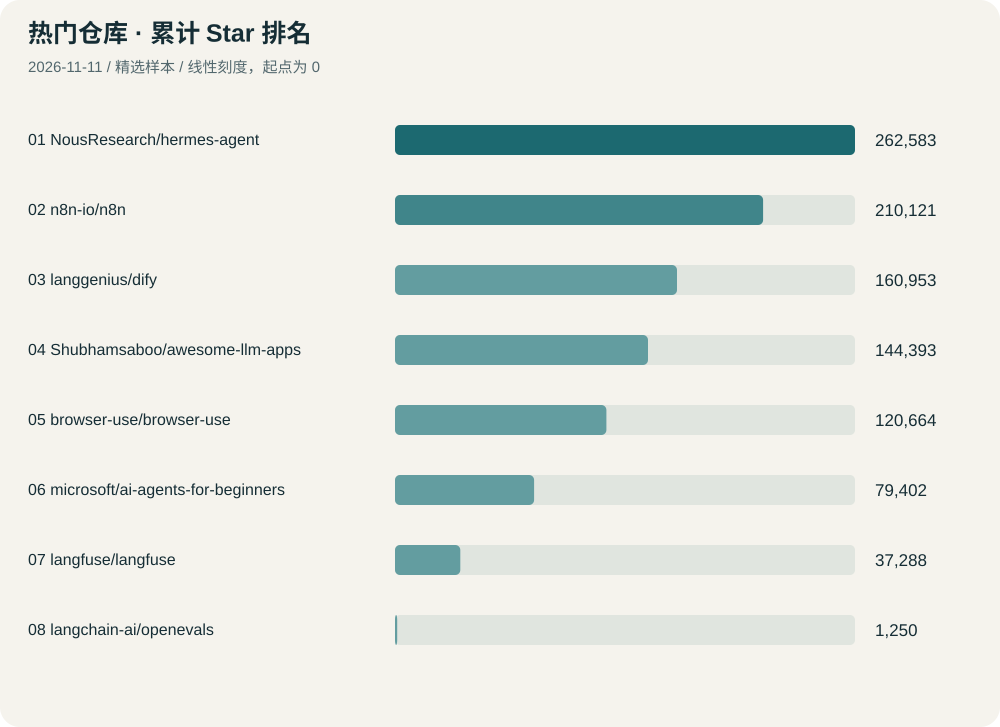
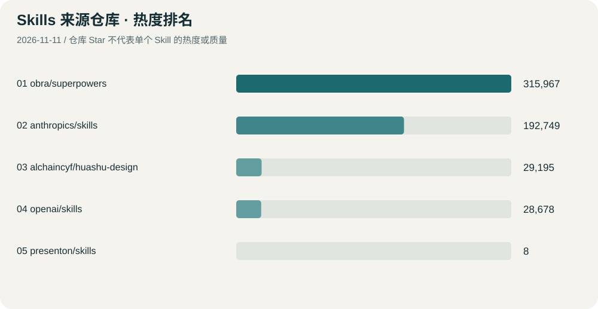

为了把“看到一个热门项目”变成“知道它能做什么、值不值得尝试”，我建立了一份聚焦 AI Agent、自动化与开发效率的公开观察清单。

**[打开 GitHub 项目与 Skills 排名页](/research/github-radar/)**：包含图表、排名表、简要介绍、使用条件与关键词筛选。页面显示实际采集时间，计划每天更新，并保留数据快照。

## 热门仓库做了什么

首批收集 6 个仓库：Hermes Agent 提供记忆、工具和技能机制；n8n 串联应用与工作流；Dify 用于搭建 AI 应用和知识库；Awesome LLM Apps 汇集示例；Browser Use 让 Agent 操作浏览器；微软的 AI Agents for Beginners 提供入门课程。

排名仅比较这份精选样本的累计 Star，不能理解为 GitHub 全站榜单、今日增速或质量评分。精确数值与最近活动日期见[排名表](/research/github-radar/#repositories)。

## Skills 应该按用途选择

Skill 是给 Agent 使用的任务说明和配套资源。我先选了 8 个，覆盖排错、验收、PR 协作、实验笔记本、浏览器操作、MCP 工具开发与前端设计。

优先关注两个具体习惯：systematic-debugging 要求先找根因；verification-before-completion 要求用验证结果支持完成声明。它们是否适合一个任务，取决于流程带来的收益是否值得额外步骤。

Skill 的推荐顺序属于编辑选择，**来源仓库的 Star 不能当成单个 Skill 的 Star**。具体介绍和使用条件见[Skills 表格](/research/github-radar/#skills)。

## 更新与证据范围

介绍依据 GitHub 仓库 README、技能的 SKILL.md 与 GitHub API。首日建立基线，没有“今日增长”；后续比较会注明快照的实际时间间隔。Trending 本次返回缓存页面，因此没有使用其今日增量。

本文及排名页由 AI 辅助检索和编排，尚未安装或运行这些推荐项，也未验证其效果或生产可靠性。下一步应选一个真实小任务尝试，记录输入、结果、失败和费用，而不是一次安装所有技能。

公开数据：[最新 JSON](/research/github-radar/data.json) · [本次快照](/research/github-radar/snapshots/2026-11-08.json) · [来源与排名口径](/research/github-radar/#method)。
