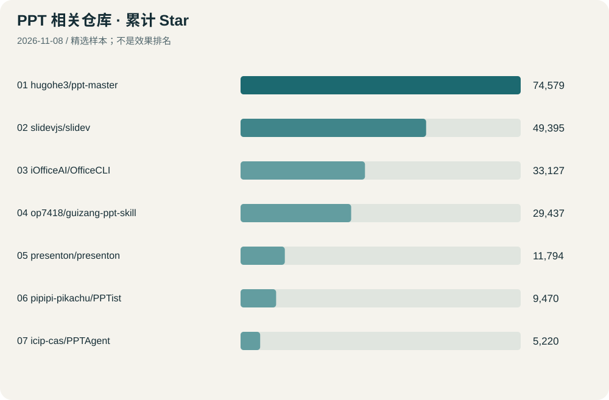
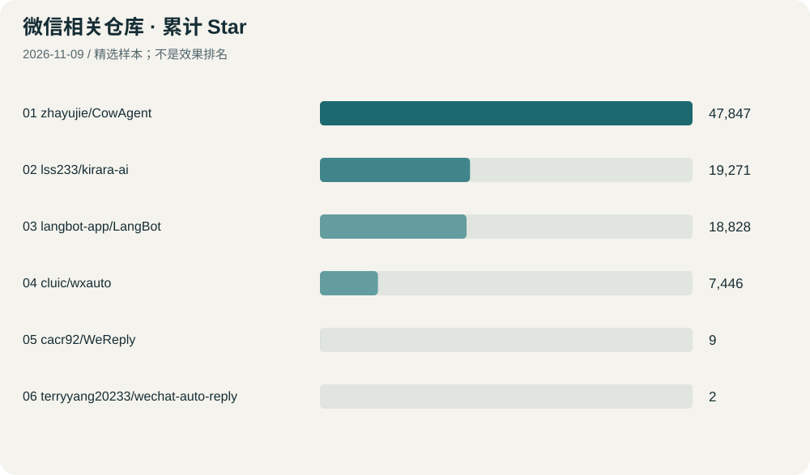

[返回 GitHub 雷达](/research/github-radar/)

**现有 PPT 精修先看 OfficeCLI；按模板重做先看 PPT Master 或 Presenton。个人微信回复建议可参考 WeReply，但它远没有热门机器人框架成熟。**

采集时间：2026-11-08T12:14:43+08:00。以下按精选样本累计 Star 排名，Star 表示关注度，不表示效果或可靠性。已核对 GitHub 元数据、README 和部分技能指南；未安装、未登录微信、未运行这些仓库。

## PPT：直接修改、重新生成、网页演示要分开看

“可导出 PPTX”不等于“能保留原有所有元素无损美化”。模型、中文字体、图表与动画兼容性都要用实际文件检查。

| 排名 | 仓库 | 累计 Star | 做了什么 / 交付形式 | 适用场景与限制 |
| --- | --- | ---: | --- | --- |
| 1 | [hugohe3/ppt-master](https://github.com/hugohe3/ppt-master) | 74,579 | 从文档、主题或现有模板生成原生可编辑 PPTX，也能抽取模板、保留设计替换内容。 **形式：**PPTX | 重做一份更有设计感的 PPT；复用已有模板。 **限制：**并非对任意旧稿无损一键美化；部分对象与跨软件效果有边界，模型调用可能收费。 最近推送：2026-11-07（UTC） |
| 2 | [slidevjs/slidev](https://github.com/slidevjs/slidev) | 49,395 | 用 Markdown 和网页组件制作演示文稿，支持主题、代码高亮与动画。 **形式：**网页演示；可导出 PDF/PNG/PPTX | 技术分享、课程讲解和开发者演示。 **限制：**不是直接美化现有 PPTX；默认 PPTX 导出为逐页图片，另有 pptx-editable 选项重建可编辑形状，部分视觉元素仍变为图片。 最近推送：2026-11-05（UTC） |
| 3 | [iOfficeAI/OfficeCLI](https://github.com/iOfficeAI/OfficeCLI) | 33,127 | 用命令读取、修改与渲染 Office 文件，可调整 PPT 元素的字体、颜色和属性。 **形式：**直接读写 PPTX | 保留已有内容，批量统一格式与精修元素。 **限制：**是 Agent 可调用的编辑工具，需要设计指令和预览检查；本次没有验证复杂母版、动画等兼容性。 最近推送：2026-10-30（UTC） |
| 4 | [op7418/guizang-ppt-skill](https://github.com/op7418/guizang-ppt-skill) | 29,437 | 生成电子杂志或瑞士设计风格的横向翻页网页演示稿，带演讲者视图。 **形式：**单文件 HTML | 分享、演讲、项目展示；参考视觉设计。 **限制：**主要交付不是 PPTX；作者也标注不适合大段表格或高信息密度培训课件。 最近推送：2026-10-30（UTC） |
| 5 | [presenton/presenton](https://github.com/presenton/presenton) | 11,794 | 提供模板、AI 生成和拖拽编辑，可使用自己的 PowerPoint 设计并导出可编辑稿。 **形式：**PPTX、PDF 等 | 希望用界面选模板、生成和调整演示文稿。 **限制：**更偏模板驱动生成与再编辑；不是保证原稿无损的自动美化。需要模型或本地推理环境。 最近推送：2026-11-06（UTC） |
| 6 | [pipipi-pikachu/PPTist](https://github.com/pipipi-pikachu/PPTist) | 9,470 | 网页端幻灯片编辑器，支持常见元素、模板和 PPTX 导入导出。 **形式：**PPTX、PDF、图片等 | 想要类似 PowerPoint 的手工编辑界面，或开发自己的编辑器。 **限制：**作者明确不保证完整 Office 兼容；复杂图表、动画和样式需用真实文件测试。AGPL-3.0，商业授权另查。 最近推送：2026-11-06（UTC） |
| 7 | [icip-cas/PPTAgent](https://github.com/icip-cas/PPTAgent) | 5,220 | 通过 Agent 制作、修改和视觉审查演示文稿，提供可编辑 PPTX 与 HTML 源稿。 **形式：**PPTX、HTML、预览与审查报告 | 研究“生成—看图检查—修改”的 Agent 工作流。 **限制：**当前 Skill 要求 Linux/WSL 或 macOS、uv、npm、LibreOffice；Windows 原生环境不属于文档列出的要求。 最近推送：2026-11-02（UTC） |

## 微信：个人回复助手与机器人是两种产品

CowAgent 等热门项目主要用来把 AI 接入聊天渠道；当前 CowAgent 的 weixin 通道是在你的会话列表新增一个机器人助手，不能据此推断它会读取并代回所有好友聊天。

**如果目标是“帮我想怎么回”，应优先看生成草稿、由人确认发送的设计。**这类精确匹配项目的 Star 很少，本次保留真实关注数，不把它们包装成热门成熟产品。

| 排名 | 仓库 | 累计 Star | 做了什么 / 交付形式 | 适用场景与限制 |
| --- | --- | ---: | --- | --- |
| 1 | [zhayujie/CowAgent](https://github.com/zhayujie/CowAgent) | 47,833 | 原 chatgpt-on-wechat，已发展为带工具、技能和记忆的多渠道 Agent 框架。 **形式：**机器人 / Agent 框架 | 在微信中与自己的 AI 助手聊天。 **限制：**当前 weixin 文档是会话列表新增机器人助手，不等于替你读取并回复全部好友聊天；不能仅凭旧项目名理解能力。 最近推送：2026-11-07（UTC） |
| 2 | [lss233/kirara-ai](https://github.com/lss233/kirara-ai) | 19,267 | 可配置模型、工作流、人设与多模态能力的聊天机器人平台。 **形式：**机器人框架 | 搭建企业微信、公众号等渠道的 AI 对话服务。 **限制：**README 当前明确列出企业微信和公众号；个人微信接入是否可用、依赖什么适配器，需另查，不能等同个人回复副驾。 最近推送：2026-10-22（UTC） |
| 3 | [langbot-app/LangBot](https://github.com/langbot-app/LangBot) | 18,791 | 带网页管理、模型接入、知识库、插件和多平台通道的机器人平台。 **形式：**机器人平台 | 公众号、企业微信或多平台客服与知识问答。 **限制：**微信通道的权限、接收范围和适配方式要分别核对；支持微信不代表能代回任意好友聊天。 最近推送：2026-11-08（UTC） |
| 4 | [cluic/wxauto](https://github.com/cluic/wxauto) | 7,444 | 通过 Windows 桌面自动化操作微信客户端，提供收发消息等基础能力。 **形式：**自动化库，不含完整回复产品 | 研究或开发 Windows 微信界面操作层。 **限制：**仓库 README 标注微信 3.9.X，不能推断支持当前微信 4.x；声明限制生产和商业用途。虽 API 元数据为 Apache-2.0，须进一步核对文档与许可的一致性。 最近推送：2026-04-13（UTC） |
| 5 | [cacr92/WeReply](https://github.com/cacr92/WeReply) | 9 | 监听当前聊天，生成不同风格的回复建议；点选后写入输入框，不自动发送。 **形式：**Windows / macOS 回复建议助手 | 个人聊天回复副驾：你选择、修改并确认发送。 **限制：**仅 9 Star，最近推送 2026-01-30；Windows 依赖 wxauto，当前微信版本兼容性未实测。聊天上下文会交给配置的模型 API。 最近推送：2026-01-30（UTC） |
| 6 | [terryyang20233/wechat-auto-reply](https://github.com/terryyang20233/wechat-auto-reply) | 2 | 读取 Mac 上已打开的微信聊天，生成草稿；由用户点击填入或确认发送。 **形式：**macOS 回复草稿助手 | Mac 上的人工确认式回复助手，参考交互设计。 **限制：**仅 2 Star，文档以 Mac 微信英文界面 3.8.x 开发；需要辅助功能权限。用户当前 Windows 环境不能直接套用。 最近推送：2026-09-01（UTC） |

## 选型建议

| 你想完成什么 | 优先查看 | 先做的验证 |
| --- | --- | --- |
| 保留一份已有 PPT 的内容，统一字号、颜色、位置 | OfficeCLI | 复制 3 页真实稿，检查文字、图表、母版是否保留 |
| 根据材料重做一份可编辑 PPT | PPT Master、Presenton | 同一份内容生成 3 页，在 PowerPoint/WPS 里手工编辑确认 |
| 想要漂亮的杂志风或瑞士风演示 | guizang-ppt-skill | 确认交付 HTML 是否符合场地和编辑要求 |
| 研究 Agent 怎样审查和修正幻灯片 | PPTAgent | 在 WSL 等文档支持环境验证依赖和视觉审查流程 |
| 在 Windows 微信聊天中获得几条候选回复 | WeReply 的交互设计 | 先验证当前微信版本能否读取和填入，不自动发送 |
| 在微信里找一个 AI 聊天入口 | CowAgent | 确认机器人会话范围、登录条件和消息权限 |
| 做企业微信或公众号的自动问答 | LangBot、Kirara AI | 确认所需渠道、触发规则与模型费用 |

## 没有列为优先推荐的旧方案

- [lich0821/WeChatFerry](https://github.com/lich0821/WeChatFerry)：6,801 Star。已归档，最近推送 2026-07-10；使用 Hook 接入，不作为新项目的优先基础。

## 使用边界与来源

微信回复内容可能涉及私人聊天；使用云模型通常会将选取的上下文发送给配置的 API。当前只做公开仓库调研，没有读取私人聊天、登录微信或自动发送消息，也不能承诺任何第三方方案“不会封号”。

代码授权与云服务收费分别查看。特别注意 wxauto 的 README 使用声明与 API 返回许可证之间存在需要核实的差异；PPTist 和 guizang-ppt-skill 使用 AGPL-3.0。开放源码不代表所有商业使用都没有条件。

每一行的仓库链接提供 README 与代码；Star、归档状态和最近推送来自 GitHub API。[查看原始采集数据](/research/github-radar/topics/ppt-wechat.json)。补充核对：

- [项目说明](https://docs.cowagent.ai/channels/weixin)
- [项目说明](https://github.com/hugohe3/ppt-master/blob/main/docs/why-ppt-master.md)
- [项目说明](https://github.com/icip-cas/PPTAgent/blob/main/skills/pptagent/README.md)
- [项目说明](https://github.com/op7418/guizang-ppt-skill/blob/main/SKILL.md)
- [项目说明](https://sli.dev/guide/exporting)
